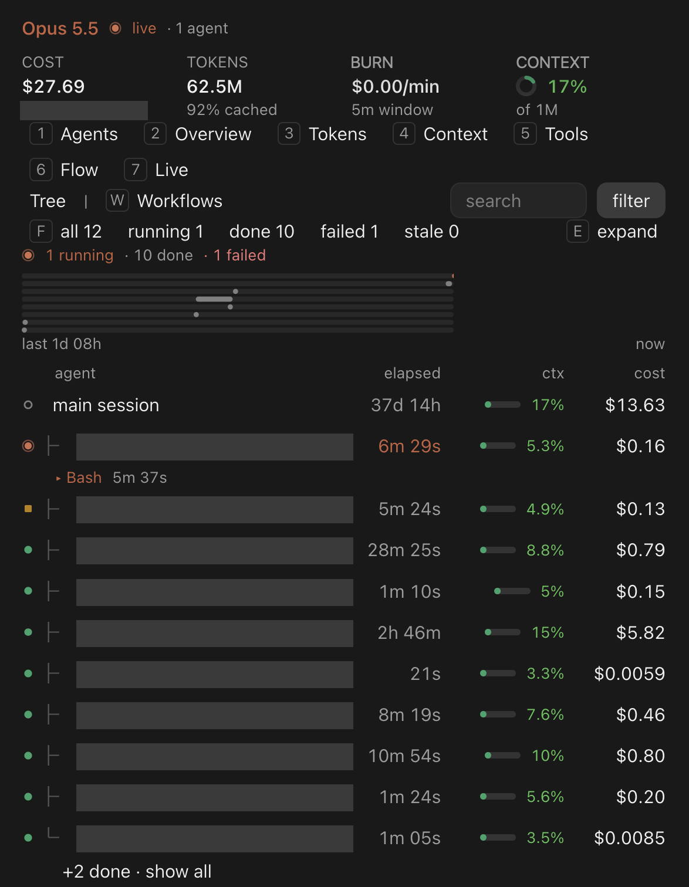
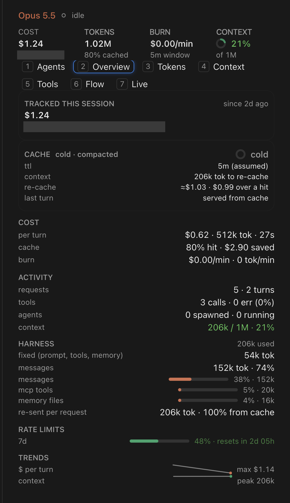
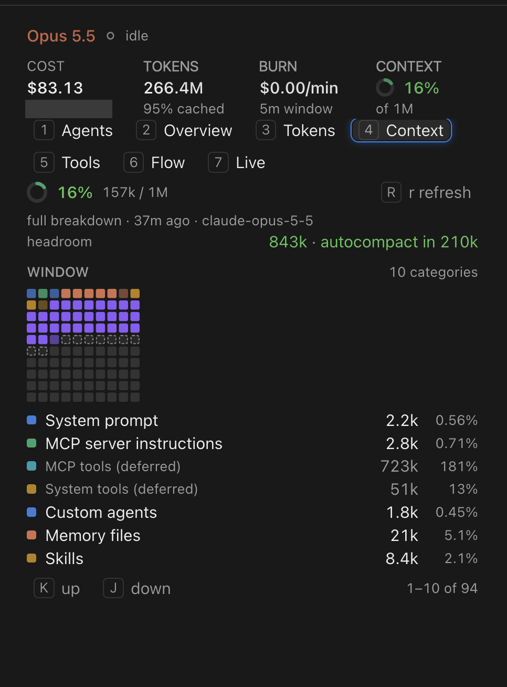
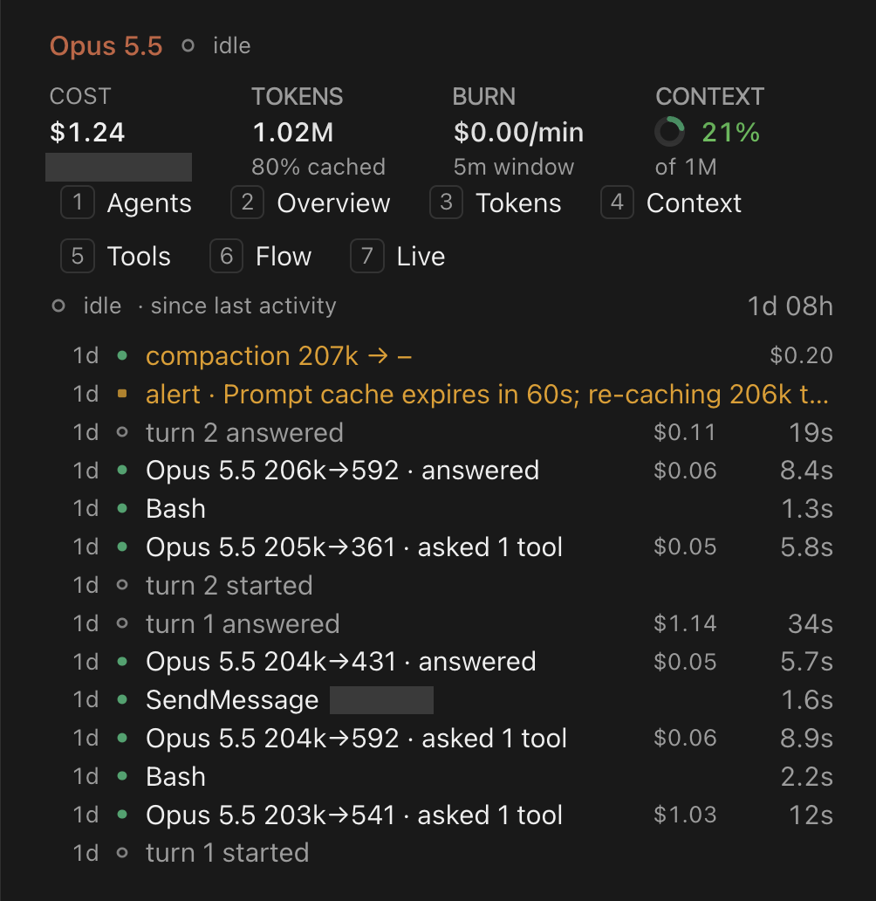
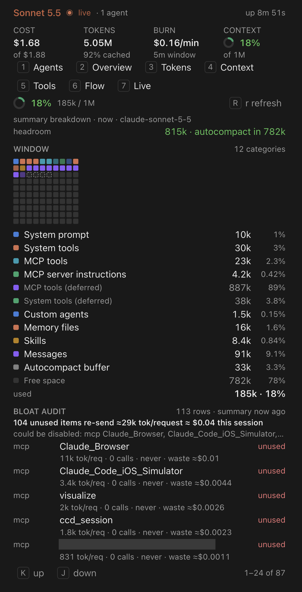

# session-telemetry

A Claude Code mod that shows live telemetry for the session it runs in: agents
(running, stale, done), cost and burn rate, tokens, the context window, tools
and data flow, with alerts for context fill, budget and burn spikes. It draws a
pane (`/telemetry`) and an optional band above the prompt, on the terminal and
in the desktop app.

## Screenshots

<table>
  <tr>
    <td width="50%" valign="top">
      
      <br>
      <sub><b>Agents.</b> Every agent in the session, running, stale or done, with its time, context use and cost.</sub>
    </td>
    <td width="50%" valign="top">
      
      <br>
      <sub><b>Overview.</b> Session cost and burn rate, the prompt-cache clock, activity, rate limits and trends.</sub>
    </td>
  </tr>
  <tr>
    <td width="50%" valign="top">
      
      <br>
      <sub><b>Context.</b> How full the context window is and which categories fill it, with the room left before auto-compact.</sub>
    </td>
    <td width="50%" valign="top">
      
      <br>
      <sub><b>Live.</b> A timeline of recent requests, tool calls, compactions and alerts.</sub>
    </td>
  </tr>
</table>

<p align="center">
  
  <br>
  <sub><b>Context, bloat audit.</b> Lists unused MCP servers and skills that are re-sent with every request, with the tokens and cost they waste.</sub>
</p>

## Install

From a terminal, add this repository as a marketplace and install the mod:

```sh
claude plugin marketplace add akhimji/claude-mod-telemetry
claude plugin install session-telemetry@session-telemetry-local
```

Then run `/reload-plugins` in running sessions, or restart them. Open the pane
with `/telemetry`.

The marketplace is named `session-telemetry-local` (the name is historical),
which is why the install command ends in `@session-telemetry-local`.

To update later:

```sh
claude plugin marketplace update session-telemetry-local
claude plugin update session-telemetry@session-telemetry-local
```

Restart running sessions afterwards to apply the update.

Use one install route per machine: the install-from-a-clone route below uses
the same marketplace name.

## Install from a clone or tarball

Clone this repository and run the install script from it:

```sh
git clone https://github.com/akhimji/claude-mod-telemetry.git
cd claude-mod-telemetry
./scripts/install.sh               # or: --dest <dir>, --dry-run
```

`install.sh` copies the folder to `~/.claude/local-plugins/session-telemetry`
(or the `--dest` folder), then runs `claude plugin marketplace add <that
folder>` and `claude plugin install session-telemetry@session-telemetry-local`
(user scope). `--dry-run` prints those commands without running them. Re-running
the script upgrades: it re-copies the folder and runs `claude plugin update`.
It never edits `settings.json` itself. Afterwards restart running sessions or
run `/reload-plugins`.

To install on a machine that cannot reach GitHub, build a tarball from a clone:

```sh
./scripts/pack.sh        # prints dist/session-telemetry-<version>.tar.gz and its sha256
```

Copy the tarball to the other machine (scp, AirDrop, ...), then there:

```sh
tar xzf session-telemetry-<version>.tar.gz
cd session-telemetry
./scripts/install.sh               # or: --dest <dir>, --dry-run
```

## Dev mode (no install)

```sh
claude --plugin-dir /path/to/session-telemetry
```

or, for sessions the desktop app or an SDK host starts, set
`CLAUDE_CODE_PLUGIN_DIRS=/path/to/session-telemetry` (process environment or
the `env` block of `~/.claude/settings.json`).

## Usage

- `/telemetry` opens (or raises) the pane with focus.
- `/telemetry full` also refreshes the full context breakdown.
- `/telemetry band auto|on|off|compact|full` sets the band above the prompt.
- Tabs: Agents, Overview, Tokens, Context, Tools, Flow, Live; hotkeys `1`-`7`
  in that order while the pane has focus.

## Options

Set in the plugin's config menu (or `--config key=value` at install):

| Option | Default | What it does |
| --- | --- | --- |
| `alertsEnabled` | `quiet` | `quiet`: only critical alerts (context 90%, budget spent) toast; `all`: warnings toast too; `off`: no alerts |
| `budgetUsd` | `0` | Warn at 80% and alert at 100% of session cost; 0 = off |
| `contextWarnPct` | `70` | Warn at this share of the auto-compact threshold; 90% is always critical |
| `burnSpikeMultiplier` | `3` | Warn when the 5-minute burn rate exceeds this multiple of the recent median (and >= $0.05/min) |
| `statusLine` | `false` | Pin a compact line under the prompt: cost, context, running agents, cache clock, top alert |

## Privacy

The pane never displays Bash command text. Telemetry lives in the session's
state only; nothing is persisted across sessions.

## Remote Control

The mod must be installed on the machine where the session runs. The desktop
app viewing that session over Remote Control draws the pane from the running
session; installing it only on the viewing machine does nothing.

## Development

- The tests are in `tests/`. They run under Claude Code's plugin engine, not a
  separate test runner: `claude plugin test .` from the mod folder.
- `claude plugin validate .` checks the manifests and reads the hooks module
  the way the engine does.
- `NOTES.md` is the design and verification log.
- `scripts/pack.sh` builds `dist/session-telemetry-<version>.tar.gz`.

## Compatibility

`NOTES.md` records the mod being verified against Claude Code CLI versions
2.1.306, 2.1.310 and 2.1.311 (tests, validation and headless loads), with type
definitions from 2.1.308. It is not guaranteed to work on other versions: the
mod uses the plugin engine's `$` interface and UI kit, which can change between
releases.

## License

MIT. See [LICENSE](LICENSE).
